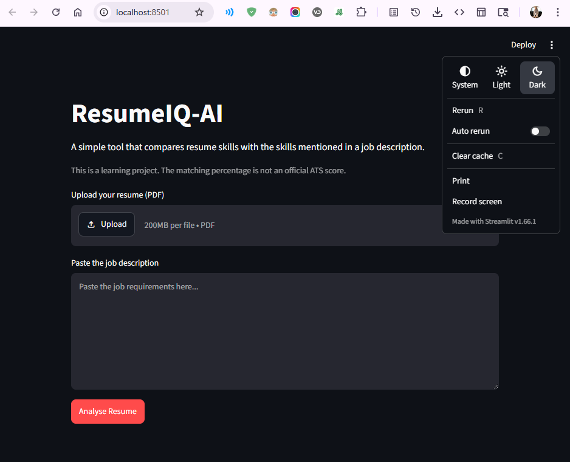
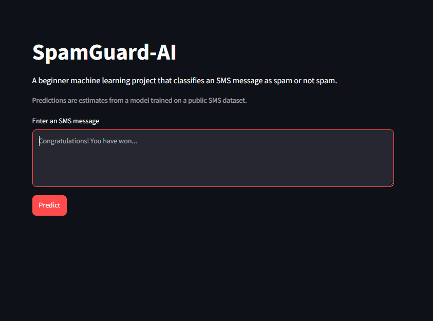
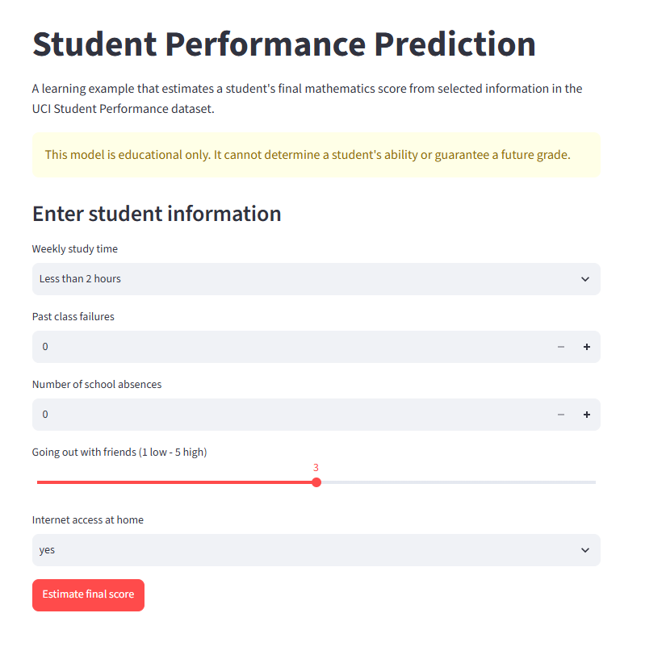
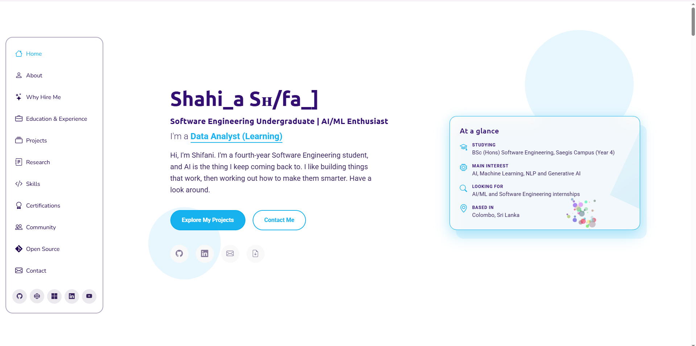
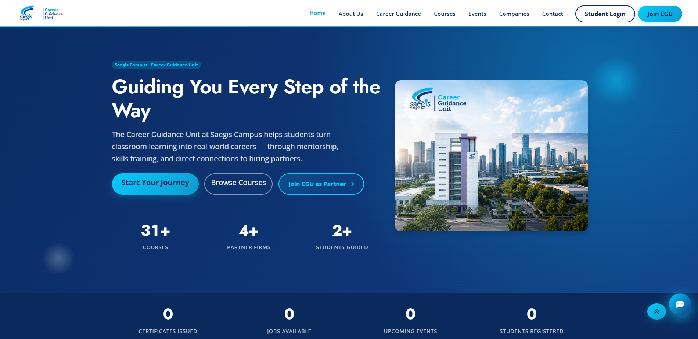
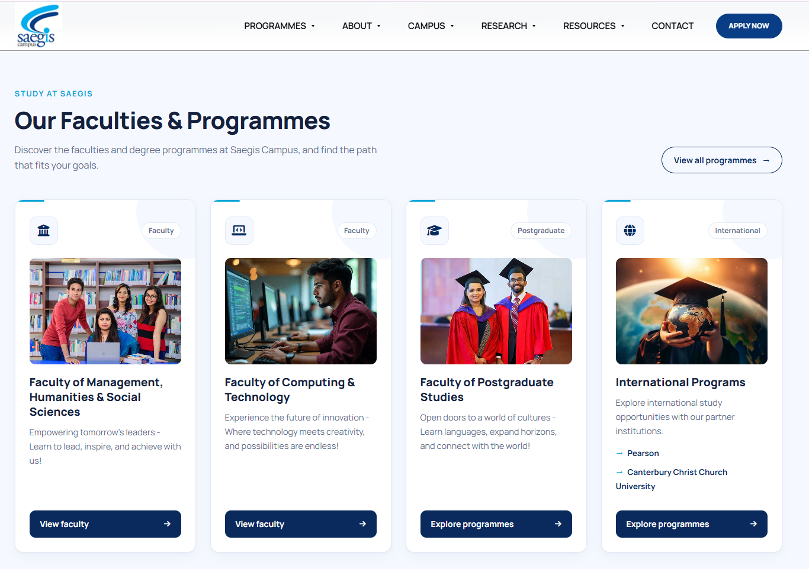

 

<!-- ANIMATED INTRODUCTION -->

<!-- CAPSULE BANNER -->

# Aspiring AI / Machine Learning Engineer

### Python · NLP · Generative AI · Data Analytics

 

<a href="https://shifani-portfolio.pages.dev">Portfolio</a> •
<a href="https://www.linkedin.com/in/shahilashifani">LinkedIn</a> •
<a href="mailto:hellooo.shifani@gmail.com">Email</a> •
<a href="https://github.com/Shahila-Shifani">GitHub</a>

  

---

## 👾 About Me

I'm Shifani, a Year 4 Software Engineering undergraduate at Saegis Campus, Sri Lanka.

I'm exploring AI, Machine Learning, NLP, Generative AI, and Data Analytics—building projects, experimenting with new technologies, and learning how to turn ideas into useful software.

- 🤖 Building AI and ML applications with Python.
- 🧠 Exploring NLP, LLMs, prompt engineering, and RAG.
- 📊 Working with data analytics and visualisation.
- 🔬 Researching AI-enhanced career guidance.
- 💻 Developing web applications and APIs.
- 🌱 Always learning. Always building.

---

## 🧰 Tech Stack

| AI & Machine Learning | Data Science | Software Engineering |
|---|---|---|
| NLP, TF-IDF, ML fundamentals | Pandas, NumPy, EDA | Python, Java, PHP |
| Generative AI, LLM concepts | Matplotlib, Scikit-learn | JavaScript, HTML, CSS |
| Prompt Engineering, RAG (learning) | Excel, Power BI (learning) | FastAPI, Flask (fundamentals) |
| Model evaluation fundamentals | SQL, Power Query, DAX (learning) | Git, GitHub, pytest |

 

---

# 🤖 AI & Machine Learning Projects

  
  

## 01 · ResumeIQ-AI

  

<table>
<tr>
<td width="48%" valign="middle">

</td>
<td width="52%" valign="top">

### 📄 AI-Powered Resume Analysis

**Status:** 🟢 Developed

An AI-powered application designed to help users understand how well their resumes match job descriptions.

**Features**
- Resume and job description text extraction.
- Text preprocessing and skill extraction.
- NLP-based resume matching workflow.
- Modular project structure and tests.

**Tech:** Python · NLP · TF-IDF · FastAPI · pytest

<a href="https://github.com/Shahila-Shifani/ResumeIQ-AI">View Repository ↗</a>

</td>
</tr>
</table>

---

## 02 · SpamGuard-AI

<table>
<tr>
<td width="48%" valign="middle">

</td>
<td width="52%" valign="top">

### 🛡️ SMS Spam Classification

**Status:** 🟢 Developed

A Machine Learning project for classifying SMS messages as spam or legitimate.

**Features**
- SMS text preprocessing.
- TF-IDF feature extraction.
- Machine Learning classification workflow.
- Prediction and API integration exploration.

**Tech:** Python · Pandas · NLTK · Scikit-learn · FastAPI

<a href="https://github.com/Shahila-Shifani/SpamGuard-AI">View Repository ↗</a>

</td>
</tr>
</table>

---

## 03 · DocuMind

<table>
<tr>
<td width="48%" valign="middle">

</td>
<td width="52%" valign="top">

### 📚 AI Document Knowledge Assistant

**Status:** 🟡 In Development

A planned RAG application that lets users upload documents and ask questions about their content.

**Planned Features**
- PDF text extraction and chunking.
- Embeddings and vector search.
- Context-grounded LLM answers.
- Source references and unknown-answer handling.

**Tech:** Python · FastAPI · LLM APIs · RAG · Streamlit

</td>
</tr>
</table>

---

## 04 · Student Performance Prediction

<table>
<tr>
<td width="48%" valign="middle">

</td>
<td width="52%" valign="top">

### 🎓 Machine Learning Project

**Status:** 🟢 Developed

Analysing student performance data and exploring predictive modelling.

**Features**
- Data cleaning and exploratory data analysis.
- Statistical exploration.
- Data visualisation.
- Predictive modelling.

**Tech:** Python · Pandas · NumPy · Matplotlib · Seaborn · Scikit-learn

</td>
</tr>
</table>

---

# 📊 Data Analytics Projects

  
  

## 05 · Sales Performance Analytics

<table>
<tr>
<td width="48%" valign="middle">

</td>
<td width="52%" valign="top">

### 📈 Business Intelligence Dashboard

**Status:** 🟢 Developed

A business intelligence project focused on analysing sales performance, revenue, profit, and product trends.

**Features**
- Sales and revenue analysis.
- Profit and margin insights.
- Data preparation and transformation.
- Interactive dashboard visualisation.

**Tech:** Power BI · Excel · SQL · Power Query · DAX

</td>
</tr>
</table>

---

## 06 · Customer Shopping Behavior Analytics

<table>
<tr>
<td width="48%" valign="middle">

</td>
<td width="52%" valign="top">

### 🛍️ Customer Data Analysis

**Status:** 🟢 Developed

Exploring shopping behaviour, customer segments, and spending patterns.

**Features**
- Data cleaning and EDA.
- Customer purchasing analysis.
- SQL-based data exploration.
- Customer preferences and behaviour insights.
- Dashboard visualisation.

**Tech:** Python · Pandas · SQL · Power BI · Excel

</td>
</tr>
</table>

---

## 07 · HR Employee Attrition Analytics

<table>
<tr>
<td width="48%" valign="middle">

</td>
<td width="52%" valign="top">

### 👥 HR Data Analytics

**Status:** 🟡 In Development

Exploring employee attrition patterns and workforce trends through data analysis.

**Features**
- Employee data analysis.
- Department and job role comparisons.
- Data cleaning and visualisation.
- HR analytics dashboard.

**Tech:** Python · Pandas · SQL · Power BI · Excel

</td>
</tr>
</table>

---

# 💻 Web Development Projects

  
  

## 08 · Personal Portfolio Website

<table>
<tr>
<td width="48%" valign="middle">

</td>
<td width="52%" valign="top">

### 🌐 My Developer Portfolio

**Status:** 🟢 Developed

My personal portfolio website showcasing my AI, Machine Learning, Data Analytics, Software Engineering projects, technical skills, research interests, certifications, and professional journey.

**Features**
- Personal introduction and professional profile.
- AI, ML, and software development project showcase.
- Technical skills and technology highlights.
- Research, certifications, and achievements.
- Contact and professional social links.

**Tech:** PHP · HTML · CSS · JavaScript

**Live Demo:** [Visit Portfolio ↗](https://shifani-portfolio.pages.dev)

**GitHub:** [View Repository ↗](https://github.com/Shahila-Shifani)

</td>
</tr>
</table>

---

## 09 · CGU Career Guidance Platform

<table>
<tr>
<td width="48%" valign="middle">

</td>
<td width="52%" valign="top">

### 🎯 Career Guidance Web Application

**Status:** 🟢 Developed

A university career guidance platform designed to support career development activities and administrative workflows.

**Features**
- Backend functionality and database operations.
- MySQL database integration.
- Admin workflows and CRUD operations.
- Functional testing and debugging.
- AI-enhanced career guidance research connection.

**Tech:** PHP · PDO · MySQL · JavaScript · Bootstrap

</td>
</tr>
</table>

---

## 09 · Saegis Campus University Website

<table>
<tr>
<td width="48%" valign="middle">

</td>
<td width="52%" valign="top">

### 🏫 University Website Development

**Status:** 🟡 In Development

A collaborative university website project focused on responsive pages and faculty-specific content.

**Features**
- Responsive page layouts.
- Faculty landing pages and navigation.
- Reusable UI components.
- Admin panel development.
- Git and GitHub collaboration.

**Tech:** PHP · Laravel · JavaScript · Bootstrap · MySQL

</td>
</tr>
</table>

---

# 📈 GitHub Statistics

  

  

---

## 🟩 Contribution Activity

<!-- Contribution activity graph -->

  

<!-- Animated contribution snake / dot-box animation -->

---

## 🔬 Research

- 🤖 **AI-Enhanced Career Guidance** — Generative AI, prompt engineering, and personalised student guidance.
- 🔐 **RSA Encryption & Cybersecurity** — Cryptography and secure digital banking research.
- 🌐 **Human-Computer Interaction** — Usability, accessibility, and website interaction quality.

---

## 🌟 Open-Source Contributions

### Eagle — Real-Time Semantic Surveillance
- Merged pytest edge-case tests and ActionClassifier regression tests.
- Added Google-style docstrings.

### Agent-DID
- Merged Node.js SDK quickstart example.
- Improved Python CI/CD workflow using GitHub Actions and Ruff.

---

## 🎓 Education & Certifications

**BSc (Hons) Software Engineering**  
Saegis Campus, Sri Lanka · Year 4 · Expected Graduation: November 2027

- Microsoft Learn Student Ambassador
- Google Cloud Arcade Facilitator Program
- AWS Academy Graduate — Cloud Security Foundations
- Microsoft AI Skills Fest 2026 Badge
- Full Stack Web Developer — University of Moratuwa
- Python Programming — University of Moratuwa

---

## 🌐 Let's Connect

  

  

### “Code. Create. Improve. Repeat.” 🚀

Thanks for visiting my profile!

